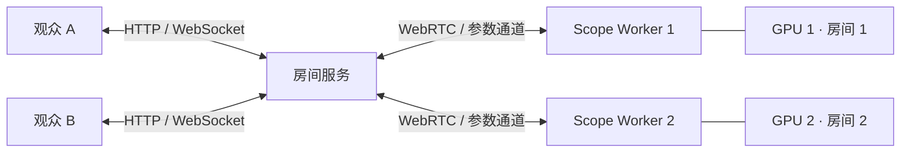

# LongLive Rooms

> **课程设计讲解：[design-guide.html](design-guide.html)**。下载后用浏览器打开，可通过交互图理解网络并发、资源分配和故障恢复。GitHub 文件页显示的是 HTML 源码。

**支持多人观看、弹幕交互和多房间并发的实时 AI 视频直播演示。**

进入网页后，从左侧选择直播间，观看持续生成的画面。房间内的观众都可以发送提示词：消息会显示为弹幕，模型根据最新的提示词逐步改变视频内容。

本项目负责网页、房间管理、视频分发、提示词调度和推理进程管理。视频生成由固定版本的 [Scope](https://github.com/daydreamlive/scope) 中的 LongLive 实现完成，适合课程演示和交互式视频生成实验。

[快速体验](#快速体验无需-gpu) · [真实模型部署](#真实模型部署) · [实测结果](#实测结果) · [开发与测试](#开发与测试) · [文档](#文档)

## 功能

- **共享直播间**：一个房间对应一条生成视频，多名观众共享输出，不为每名观众重复启动模型。
- **弹幕交互**：每条被接受的提示词进入房间消息流，可显示为画面上的移动弹幕。
- **优先最新提示词**：短时间内收到多条消息时，保留最新一条尚未投递的指令，避免排队播放过时内容。
- **多房间并发**：默认两个房间，Worker 数量、GPU 绑定和生成容量均可配置。
- **房间隔离**：切换直播间、关闭网页或观众断线不会停止其他人的生成任务。
- **资源回收**：托管 Worker 通过受控进程重建和模型就绪检查恢复；不能确认清理完成的 Worker 会被隔离。
- **Docker 部署**：支持无 GPU 的 Mock，以及真实模型的共享盘环境和完整镜像两种部署方式。
- **私人访问**：网页、弹幕和视频可以通过一个 SSH TCP 隧道访问，无需为浏览器单独开放媒体端口。

## 实测结果

在两张 **NVIDIA A800 80GB** 上，使用 **384×224、BF16、每个 Worker 一张 GPU** 的配置完成了真实双路验证。

| 指标 | 房间 1 | 房间 2 |
|---|---:|---:|
| 服务端视频接收帧率 | 21.40 FPS | 21.32 FPS |
| 模型原始生成帧率 | 23.40 FPS | 22.94 FPS |
| 视频接收测量时长 | 30 秒 | 30 秒 |

接收帧率在服务器本机测量，模型帧率来自独立的生成批次日志；浏览器实际播放还受网络和设备影响。冷启动、模型加载与开始生成的等待时间另行记录，不计入上述稳定运行帧率。

| 验收层级 | 状态 | 已验证内容 |
|---|---|---|
| Level 1：软件框架 | PASS | 23 项测试、前端构建、接口契约、Mock 媒体链路和生命周期 |
| Level 2：真实单路 | PASS | 实际生成画面、提示词引起场景变化、资源回收与复用 |
| Level 3：真实并发 | PASS | 两路同时生成、共享观看、提示词隔离和单路故障恢复 |

这些结果对应已测试的版本和配置。更高分辨率、两路以上并发及长时间连续运行尚未验证。完整环境、测量过程和限制见[验收记录](results/validation.md)。

## 快速体验：无需 GPU

安装 Docker Engine 和 Docker Compose 后，在仓库根目录执行：

```bash
docker compose up --build -d
```

打开 **http://127.0.0.1:8080**，选择一个直播间并发送提示词。

此方式运行 **Mock**：带房间标识和帧号的诊断画面，用于体验网页、弹幕和多观众共享流程，不执行 AI 视频推理。

查看状态与日志：

```bash
docker compose ps
docker compose logs --tail=100 hub
```

停止：

```bash
docker compose down
```

Mock 的 Compose 项目名是 `longlive-mock`，真实部署默认使用 `longlive-rooms`。两者同时运行时，需要选择不同的入口端口。

## 真实模型部署

### 环境准备

需要 Linux、Docker Compose、NVIDIA Container Toolkit，以及获准使用的 NVIDIA GPU。共享盘部署还需要 Git、Python 3、uv 0.9.11；构建前端需要 Node.js 20.19+ 或 22。

当前验证使用一张 A800 对应一个生成房间，双路使用两张卡；这不是对其他显卡最低配置的承诺。模型清单共约 **17.3 GB**，Python/CUDA 依赖及下载缓存还会占用额外空间。

| 部署方式 | 依赖位置 | 验证情况 |
|---|---|---|
| 共享盘环境 + 小型 Docker 镜像 | 项目目录中的 Python 环境，容器只读挂载 | 已完成真实双路验收 |
| 完整 Scope Docker 镜像 | Python/CUDA 依赖在镜像内 | 生成配置已检查，尚未完成此路径的 GPU 验收 |

### 方式一：共享盘环境

以下命令在部署机器的项目根目录执行。也可以在开发机器构建前端，再把干净源码和 `dist/` 一起传到部署机器。

```bash
# 1. 构建网页
npm ci
npm run build

# 2. 安装固定版本的 Python 和 Scope 依赖
bash scripts/prepare_shared_runtime.sh

# 3. 下载并校验模型
python3 scripts/download_verified_models.py
python3 scripts/verify_models.py

# 4. 构建应用镜像
docker build -f deploy/Dockerfile.runtime -t longlive-runtime:0.1.0 .

# 5. 生成当前机器的部署配置
# 0,1 是示例，请换成自己获准使用且空闲的 GPU。
runtime/hub-env/bin/python scripts/render_scope_deployment.py \
  --gpu-ids 0,1 \
  --width 384 --height 224 \
  --port 8080 \
  --runtime-root "$PWD/runtime" \
  --worker-startup-timeout 300

# 6. 启动服务
docker compose -f compose.scope.local.yaml up --no-build -d
```

首次启动需要加载模型，页面会显示准备状态。网络受限时，可以使用已经核对官方文件哈希的下载镜像：

```bash
python3 scripts/download_verified_models.py \
  --mirrors configs/models.mirrors.json \
  --workers 8 --file-workers 2
```

已完成的下载分块可复用，安装前仍需通过 SHA256 校验。依赖下载镜像、基础镜像导入、GPU 内核检查及共享盘注意事项见[完整部署步骤](docs/shared-disk-runtime.md)。

### 方式二：完整镜像

希望将 Python/CUDA 依赖放入镜像时，使用[完整镜像部署说明](deploy/README.md#完整镜像部署)。两种方式使用相同的房间服务和 Worker 生命周期管理；完整镜像占用更多 Docker 存储空间。

### 从自己的电脑访问

服务默认只监听服务器回环地址。在自己的电脑执行：

```bash
ssh -N -L 127.0.0.1:8080:127.0.0.1:8080 YOUR_SSH_ALIAS
```

或者，在已有本项目源码的电脑上执行：

```bash
bash scripts/tunnel.sh YOUR_SSH_ALIAS 8080 8080
```

保持终端打开，访问 **http://127.0.0.1:8080**。脚本后两个参数分别为本地端口和服务器端口；本地 8080 被占用时，可以把第一个改为 8787，再打开对应地址。

### 停止真实部署

```bash
docker compose -f compose.scope.local.yaml down
```

生成的 `compose.scope.local.yaml` 和 `configs/workers.local.yaml` 只用于当前机器，不提交 Git。重新生成时，脚本会拒绝覆盖已有文件；需要替换配置时，先保存手动修改，再提供完整参数并加 `--force`。

## 工作方式



浏览器连接 FastAPI 房间服务。每个正在生成的房间只建立一条通往 Scope 的上游 WebRTC 连接，服务端接收视频后，将最新 JPEG 帧分发给该房间的观众。浏览器使用 WebSocket 接收画面和房间事件。

观众连接与生成任务分别管理：离开房间只关闭该观众的连接，主动停播才会触发生成资源回收。慢观众只保留最新画面，不会无限积压旧帧。

提示词由房间服务统一排序、去重和投递：所有被接受的消息都显示为弹幕，模型只优先接收最新的未投递指令。已经发出的指令无法保证撤回；界面上的“已投递”表示发送成功，不代表画面已经完全符合提示词。

## 配置

| 配置项 | 位置 | 用途 |
|---|---|---|
| Worker 和房间列表 | `configs/workers.local.yaml` | 后端地址、初始提示词、房间名称和数量 |
| GPU、分辨率、入口端口 | `scripts/render_scope_deployment.py` 参数 | 生成对应的 Compose 与 Worker 配置 |
| `media_fps`、`jpeg_quality` | Worker 配置顶层 | 浏览器中继流的帧率上限和 JPEG 质量 |
| `prompt_interval_s`、`prompt_ttl_s` | Worker 配置顶层 | 提示词投递间隔和待投递有效期 |
| 进程、模型、首帧超时 | 部署生成器参数 | 分别控制不同启动阶段的等待期限 |
| 本地开发环境变量 | 由 `configs/example.env` 复制的 `.env` | Mock 数量、心跳、容量与日志路径 |

更多 GPU 使用显式列表，例如 `--gpu-ids 0,1,2,3`。Worker 数量决定生成容量，默认房间仍为两个；可通过网页创建其他房间，或修改生成的房间列表。现有观众不会额外消耗生成槽位。

心跳、媒体连接、首帧等待和模型恢复使用各自的超时控制。Worker 经过进程替换和模型重新就绪后才返回可用状态，单次 HTTP 健康检查不作为旧会话已清空的依据。

## 开发与测试

### 本地运行

需要 Python 3.12、uv 和 Node.js 20.19+ 或 22：

```bash
cp configs/example.env .env
bash scripts/dev_mock.sh
```

访问 http://127.0.0.1:8080 ，按 Ctrl+C 停止。这里使用本地 Mock，无需 GPU。

### 自动化验证

```bash
uv sync --frozen
npm ci
uv run pytest -q
npm run build
```

服务启动后，可执行媒体和房间检查：

```bash
uv run python scripts/smoke_api.py --rooms 2 --seconds 30

# 此项会停止并重开指定房间，同时检查另一房间继续生成
uv run python scripts/smoke_recovery.py \
  --room night-walk --other-room floating-garden
```

浏览器验证：

```bash
uv run playwright install chromium
uv run python scripts/browser_smoke.py
```

已有浏览器可通过 `--browser /path/to/chrome` 指定。测试报告默认写入被 Git 忽略的 `artifacts/`；浏览器测试会生成可能包含弹幕的截图。

GitHub Actions 已配置软件测试、前端构建、Docker 构建和 Mock 冒烟测试，不使用 GPU，也不自动发布镜像。真实模型验收需要在 GPU 环境单独执行。

## 项目结构

```text
.
├── longlive/                 # 房间服务、媒体适配器与资源生命周期
├── web/                      # TypeScript 网页
├── api/openapi.yaml          # 与实际服务一致的 HTTP 接口契约
├── configs/                  # 配置模板、模型/源码/镜像锁定清单
├── deploy/                   # Dockerfile、进程 supervisor、Scope 兼容层
├── scripts/                  # 下载、部署、验证与源码打包
│   └── ops/                  # 可选的网络受限环境运维工具
├── tests/                    # 软件与部署测试
├── docs/                     # 实现规格、协议和部署说明
├── results/                  # 已执行的验证结果
├── Dockerfile                # 自带依赖和网页的 hub 镜像
└── compose.yaml              # 无 GPU Mock 演示
```

权重、环境、缓存、私有配置和原始运行记录均不进入 Git。旧方案保存在 `docs/archive/`，不属于当前实施契约，也不进入干净源码导出包。

## 常见问题

**网页打开了，但还没有画面。**

先查看房间是否仍在准备，再检查 `docker compose -f compose.scope.local.yaml logs --tail=100 hub worker-1 worker-2`。初次 Python 导入、权重加载和推理预热需要时间，共享盘冷启动可能更慢。

**发送提示词后，为什么旧画面还在？**

模型会逐步改变场景，可能保留原有元素；新消息覆盖尚未投递的旧指令，并不保证瞬间切换或逐条执行全部弹幕。

**停止直播后，资源为什么没有立即空出来？**

系统会先关闭媒体连接、重建自有进程并重新加载模型，验证后才释放槽位。实测正常回收约 64 秒，随后重开约 67 秒，具体耗时受环境影响。

**能直接作为公网直播服务使用吗？**

当前面向私人演示，没有账号、访问权限和持久化房间状态。建议按文档通过 SSH 隧道访问；公开服务需要另行实现相应能力。

## 文档

- [Docker 部署总览](deploy/README.md)
- [共享盘部署步骤](docs/shared-disk-runtime.md)
- [实现规格](docs/implementation_spec.md)
- [WebSocket 媒体与弹幕协议](docs/stream-protocol.md)
- [固定 Scope 版本与兼容改动](docs/compatibility.md)
- [真实模型验收](results/validation.md)与[源码发布检查](results/release-readiness.md)
- [GitHub 上传与源码打包](docs/github.md)

## 许可与致谢

**本项目暂未指定许可证。** Scope、LongLive 以及模型、依赖库保留各自的许可；本项目的源码包不包含第三方模型权重或 Scope 源码。具体来源和固定版本说明见 [THIRD_PARTY_NOTICES.md](THIRD_PARTY_NOTICES.md)。

感谢 [Scope](https://github.com/daydreamlive/scope) 与 [LongLive](https://github.com/NVlabs/LongLive) 提供的视频生成实现与研究工作。
